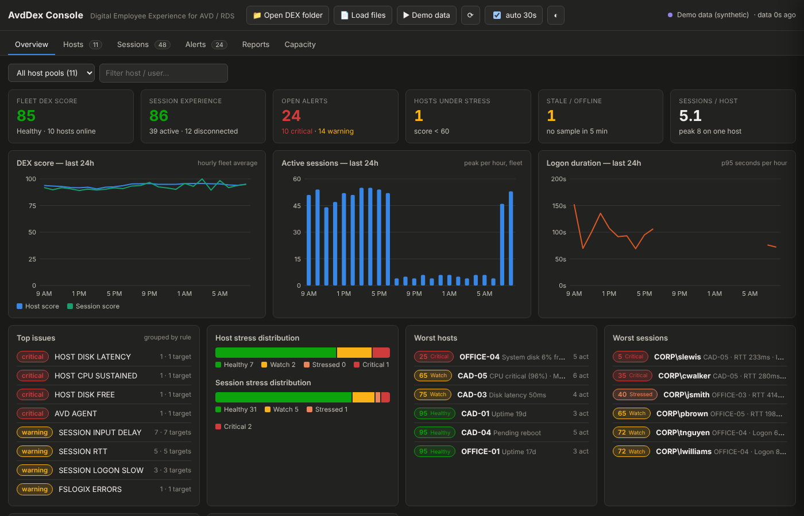
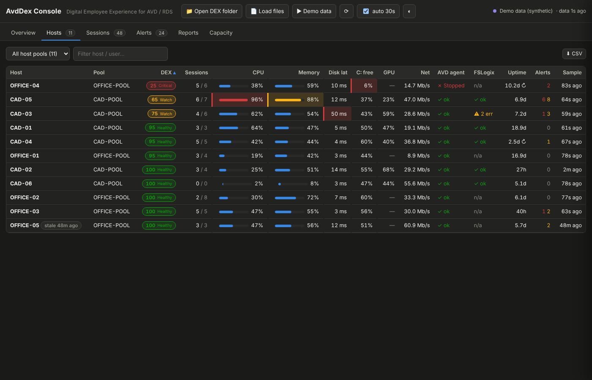
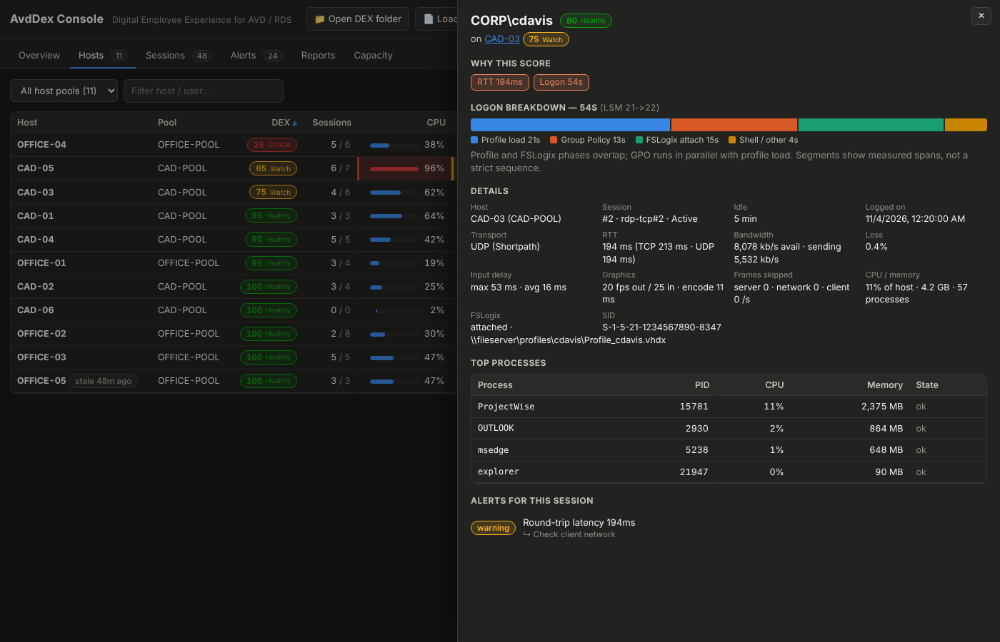

# AvdDex — open Digital Employee Experience monitoring for AVD / RDS

A self-hosted, ControlUp-style DEX stack for Azure Virtual Desktop and RDS session hosts, in plain PowerShell
and one HTML file. An agent on every host, a "monitor" that aggregates the fleet, a browser console with no
credentials in it, alert rules tied to remediation scripts, and long-term history with right-sizing suggestions.

No SaaS, no database, no agent framework: hosts write JSON to a file share, a scheduled script rolls it up, and
the console reads the share straight from the browser.



```
 Session hosts (SYSTEM scheduled task)          Collector (any box that reads the share)              Anyone with the share
 ┌──────────────────────────┐  latest\HOST.json  ┌───────────────────────────┐  fleet.json / trends.json  ┌───────────────────────┐
 │ AvdDexAgent.ps1  every 30s│ ─────────────────► │ Merge-AvdDexFleet.ps1      │ ─────────────────────────► │ AvdDex-Dashboard.html  │
 │  host + session telemetry │  history\HOST\*.jsonl│  every 2–5 min             │  rollups\ alerts\ reports\ │  Edge/Chrome, folder   │
 │  DEX score, alert rules   │ ─────────────────► │  hourly/daily rollups       │                            │  picker, auto-refresh  │
 └─────────┬────────────────┘                    └───────────────────────────┘                            └───────────────────────┘
           │ Application log 1001/1002 (RMM condition)      ▲
           │ optional webhook POST (ticketing / automation) │ Invoke-AvdDexRemediation.ps1 reads latest\HOST.json
           ▼                                                │ and runs the enabled actions ("triggers")
```

| ControlUp concept | AvdDex |
|---|---|
| Agent | `AvdDexAgent.ps1` — scheduled task as SYSTEM, loop every `IntervalSeconds` (default 30 s, min 10) |
| Monitor / data collector | `Merge-AvdDexFleet.ps1` — scheduled on one machine that can read the share |
| Real-Time DX console | `AvdDex-Dashboard.html` — single file, no dependencies, no credentials |
| Stress level | DEX score 0-100 → Healthy ≥80 · Watch ≥60 · Stressed ≥40 · Critical <40 (plus A–F grade) |
| Triggers → scripts | alert rules in the agent + `Invoke-AvdDexRemediation.ps1` (dry-run by default, every action opt-in) |
| Organization tree | `HostPool` + `Tags` in the agent config (filter in the console) |
| Synthetic tests | `SyntheticProbePath` — any probe's JSON result is merged into each snapshot |
| Long history | raw `history\*.jsonl` + cached hourly/daily rollups; nothing is ever deleted automatically |
| Right-sizing | `RightSizing` in fleet.json from 7-day P95 CPU / memory / peak sessions (Capacity tab) |

## Files

| File | Runs on | Purpose |
|---|---|---|
| `AvdDexAgent.ps1` | every session host | collector + scorer + alerting |
| `Install-AvdDexAgent.ps1` | every session host (admin) | copies agent, writes config, enables input-delay counters, registers task |
| `Deploy-AvdDexAgent-NinjaOne.ps1` | RMM (SYSTEM) | install / uninstall / status / sample via script variables (NinjaOne; trivially adapted to Intune/Datto/etc.) |
| `Merge-AvdDexFleet.ps1` | collector box | fleet.json, trends.json, rollups, alert history, CSV reports |
| `Invoke-AvdDexRemediation.ps1` | session host (RMM) | alert → action, dry-run unless `-Execute` |
| `AvdDex-Dashboard.html` | browser | console |
| `config/*.sample.json` | — | annotated config samples |

Requirements: Windows Server 2019+ or Windows 10/11 Enterprise multi-session, PowerShell 5.1 (7.x works),
a file share the hosts' computer accounts can write to. Edge or Chrome for the folder picker (other browsers:
load files or host over HTTP).

## Quick start

1. **Share** — create `\\fileserver\AvdDex` with Modify for `Domain Computers` (agents run as SYSTEM) and copy the scripts to `\\fileserver\AvdDex\bin\`.
   Azure Files works too (AD DS / Kerberos authentication on the storage account + NTFS Modify).
2. **Hosts** — on each host, or in the gold image:
   ```powershell
   .\Install-AvdDexAgent.ps1 -SharePath '\\fileserver\AvdDex' -HostPool 'CAD-POOL' -Tags CAD,GPU
   ```
   or push `Deploy-AvdDexAgent-NinjaOne.ps1` from your RMM with script variables `dexSharePath`, `dexHostPool`,
   `dexTags`, `dexInterval`, `dexWebhook`, `dexAction` (install | uninstall | status | sample). `status` exits 1
   when the agent is missing or stale, so it doubles as a condition script.
3. **Collector** — on any box that reads the share:
   ```
   schtasks /create /tn "AvdDex Merge" /sc minute /mo 3 /ru SYSTEM /tr "powershell -NoProfile -ExecutionPolicy Bypass -File C:\AvdDex\Merge-AvdDexFleet.ps1 -SharePath \\fileserver\AvdDex -OrgName Contoso"
   ```
4. **Console** — open `AvdDex-Dashboard.html` → **Open DEX folder** → pick `\\fileserver\AvdDex`. It reads
   fleet.json/trends.json (or the raw `latest\*.json` if the merge isn't running yet) and re-reads every 30 s.
   Add `#demo` to the URL to explore with synthetic data.

The installer sets `HKLM\SYSTEM\CurrentControlSet\Control\Terminal Server\EnableLagCounter = 1`; the
**User Input Delay** counters only appear for sessions started after that.

Share layout the agents and merge create:
```
\\fileserver\AvdDex\
  bin\                               scripts (for RMM pulls)
  latest\HOST.json                   newest snapshot per host (atomic write via .tmp + rename)
  history\HOST\yyyy-MM-dd.jsonl      one compact line per cycle (~1–2 KB)
  fleet.json  trends.json            written by the merge
  rollups\hourly\HOST_yyyy-MM-dd.json   cached day rollups (merge)
  alerts\yyyy-MM-dd.jsonl            de-duplicated alert history (merge)
  reports\*.csv                      daily CSVs (merge)
```
If the share is unreachable the agent still writes everything locally to `C:\ProgramData\AvdDex`.

## Console

| Tab | What you get |
|---|---|
| Overview | fleet KPIs, 24 h score / sessions / logon charts, top issues by rule, worst hosts & sessions, slowest logons, infra health |
| Hosts | heat-coloured grid (CPU, memory, disk latency, free space, GPU, AVD agent, FSLogix, uptime, alerts) → drawer with score factors, 24 h sparklines, disks, sessions, top processes |
| Sessions | user, state, DEX, transport (UDP Shortpath / TCP), RTT, input delay, FPS, bandwidth, CPU, memory, logon time, top process → drawer with logon-phase bar and full protocol detail |
| Alerts | open alerts with suggested remediation, severity filters, history chart, most frequent rules |
| Reports | 24 h / 7 d / 30 d / 90 d DEX and logon trends, peak sessions, application usage, host scorecard, slowest users and logons, CSV + print |
| Capacity | right-sizing suggestions per host with a CPU-vs-memory P95 envelope |




## What the agent collects

**Host** — CPU %, run-queue/core, context switches, memory %, available MB, commit %, pages/s, per-disk
read/write latency, queue, IOPS, free %, network bytes/s, output queue, TCP retransmits/s, GPU engine % and
dedicated memory (GPU SKUs), uptime, pending reboot (CBS/WU/PendingFileRename), OS build, top 10 processes.

**AVD agent** — RDAgentBootLoader state, RDAgent process, `IsRegistered`, agent version (skipped on plain RDS).
**FSLogix** — frxsvc state, version, Profiles enabled, errors in the interval (`Microsoft-FSLogix-Apps/Operational`).

**Per session** (from `quser` + perf counters + Get-Process):
- state, idle, logon time, SID, console flag
- `RemoteFX Network`: TCP/UDP RTT, bandwidth, send rate, loss → `Transport` = UDP (Shortpath) when UDP RTT > 0
- `RemoteFX Graphics`: encode time, in/out FPS, frames skipped (server / network / client)
- `User Input Delay per Session`: max + avg
- CPU % of host (counter-based, summed over session processes), memory, process count, top N processes, not-responding apps
- FSLogix container attach state + VHD path (`HKLM\SOFTWARE\FSLogix\Profiles\Sessions\<SID>`)
- logon breakdown: total (LSM event 21 → 22, or → explorer start), profile load (User Profile Service 1 → 2),
  GPO (GroupPolicy 8001 elapsed), FSLogix (span of FSLogix events for the SID), shell. Cached per session.

**Interval events** — LSM 23/24/25 (logoff/disconnect/reconnect), Application Error 1000 / Hang 1002.

## Scoring

Host starts at 100 and loses points: CPU ≥80/92/95 → −10/−25/−40 (max of current and sustained avg over the last
5 samples) · run queue ≥2/core −10 · memory ≥85/94/97 → −10/−25/−40 · paging ≥1000/s −5 · disk latency ≥20/45/100 ms
→ −10/−25/−40 · system disk free ≤15/7/3 % → −10/−20/−35 · TCP retransmits ≥5/s −10 · GPU ≥85/97 % −10/−20 · AVD agent
unhealthy −50 · FSLogix service stopped −30 · FSLogix errors −10 each (max −30) · app crash/hang −5 each (max −20) ·
pending reboot −5 · uptime ≥14 d −5.

Active session starts at 100: RTT ≥120/220/350 ms → −10/−25/−45 · input delay ≥400/1000/2000 ms → −10/−25/−45 ·
frames skipped ≥5/15 per s → −10/−25 · session CPU ≥50/85 % → −10/−25 · memory ≥8/16 GB → −5/−10 · logon ≥45/90/180 s
→ −10/−25/−40 · hung app −15 · disconnected during interval −10 · host pressure −(60−hostScore)/2 when host < 60.
Disconnected sessions only lose points for sitting idle ≥8 h (−20).

Thresholds live in `agent.config.json → Thresholds` and are re-read every cycle.

## Alert rules → remediation

| Rule | Sev | Fires when | Suggested / automated action |
|---|---|---|---|
| HOST_CPU_SUSTAINED | warn/crit | avg over last 5 samples ≥ CpuWarn/CpuCrit | log top process (never automatic) |
| HOST_MEM_SUSTAINED | warn/crit | sustained ≥ MemWarn/MemCrit | log off stale disconnected sessions |
| HOST_DISK_LATENCY | warn/crit | worst disk ≥ 20/45 ms | disk tier, AV exclusions |
| HOST_DISK_FREE | warn/crit | system disk ≤ 15/7 % | clear temp + WU cache (`HOST_DISK_FREE` action) |
| HOST_NET_RETRANSMIT | warn | ≥ 5 retransmits/s | vNIC / NSG / accelerated networking |
| HOST_GPU | crit | GPU ≥ 97 % | rebalance sessions |
| AVD_AGENT | crit | service/agent/registration unhealthy | restart RDAgentBootLoader (`AVD_AGENT` action) |
| FSLOGIX_SERVICE / FSLOGIX_ERRORS | crit / warn | frxsvc stopped / errors in interval | start frxsvc (`FSLOGIX_SERVICE` action) |
| APP_CRASH | warn | Application Error / Hang events | review log |
| HOST_PENDING_REBOOT / HOST_UPTIME | info | pending reboot / ≥14 d | reboot in window with no active sessions (`HOST_PENDING_REBOOT` action) |
| SESSION_RTT / SESSION_INPUT_DELAY | warn/crit | thresholds above | client network / top processes |
| SESSION_FRAMES_SERVER / _NETWORK | warn | ≥10 skipped/s | host encoder or client bandwidth |
| SESSION_CPU | warn | session ≥ SessionCpuCritPct | runaway process |
| SESSION_LOGON_SLOW | warn | logon ≥ LogonCritSec | profile size / GPO / scripts |
| SESSION_APP_HUNG | warn | process not responding | end process if still hung and on allow-list (`SESSION_APP_HUNG` action) |
| SESSION_STALE_DISCONNECT | info | disconnected ≥ 8 h | `logoff` (`SESSION_STALE_DISCONNECT` action) |

Warning/critical alerts go to the Application log as source **AvdDex Agent**, event **1001** (warning) /
**1002** (critical); remediation actions log **1003**. Point an RMM condition at those IDs, or set `WebhookUrl`
to POST `{source, host, hostPool, timestamp, hostScore, alerts[]}` to your automation.

`Invoke-AvdDexRemediation.ps1` writes an all-disabled `remediation.config.json` on first run. Enable actions
per host pool, test with no switches (dry run prints what it would do), then schedule with `-Execute`.

## Retention and deletion (deliberately conservative)

- Agent `HistoryRetentionDays` defaults to **0 = keep everything** (~3–6 MB/host/day at 30 s). Set it once the
  merge's rollups cover what you need; Reports use rollups past 7 days anyway.
- The merge script never deletes. Rollup cache files are ~30 KB/host/day.
- Remediation deletes only temp files (optionally the WU download cache), only when `HOST_DISK_FREE` is enabled and `-Execute` is used.

## Integrations

- **Grafana**: JSON/Infinity datasource on `fleet.json` / `trends.json`, or Promtail → Loki on `history\*.jsonl`.
- **Synthetic logon probes**: write the probe's result JSON to a path and set `SyntheticProbePath`; it shows in the host drawer.
- **HTTP hosting**: serve the share folder statically and the console loads `fleet.json` automatically (no folder picker needed).

## Known limitations

- `RemoteFX Network` / `Graphics` counter instances are matched to sessions by the trailing number of the
  instance name (`RDP-Tcp 12` ↔ `rdp-tcp#12`), falling back to the session ID. Verify on your build with
  `Get-Counter -ListSet 'RemoteFX Network'`.
- Logon phases overlap (GPO runs during profile load; FSLogix is a span of its events) — segments are measured spans, not a strict sequence.
- `quser` parsing assumes en-US date formatting.
- GPU counters only exist on GPU SKUs; `Gpu` is null elsewhere and GPU rules are skipped.
- A collection cycle takes ~1–3 s on a busy host (perf counters sample for 1 s); `CollectionMs` is in every snapshot.
- The console's folder access needs the File System Access API (Edge/Chrome). Other browsers: Load files, drag-drop, or HTTP hosting.

## Contributing

Issues and PRs welcome — counter-mapping fixes for other Windows builds, locale-safe session enumeration, and
extra remediation actions are the obvious next steps. Keep the agent PowerShell 5.1 compatible and the console dependency-free.

## License

MIT © 2026 Warren Anderson Consulting LLC
